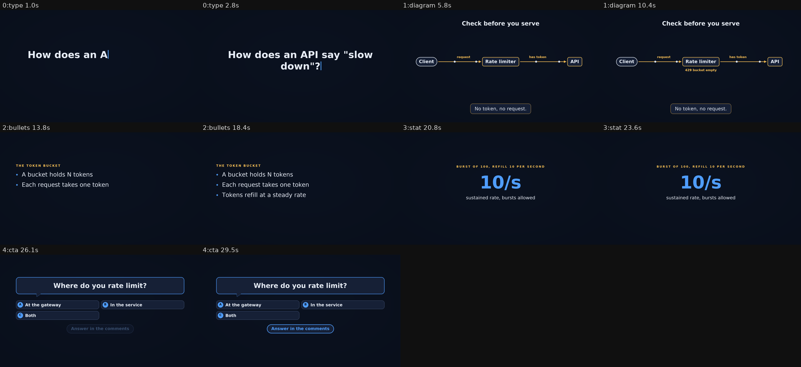

# yamlreel-video

An [Agent Skill](https://agentskills.io) that lets an AI agent (Claude Code and compatible clients) turn a topic into a
finished short video: YouTube Shorts / Reels / TikTok (vertical 1080x1920), landscape (1920x1080) or square
(1080x1080). The agent writes a YAML spec and renders it locally with the open-source
[yamlreel](https://pypi.org/project/yamlreel/) CLI. You get `video.mp4`, `poster.jpg`, `contact.png` and a ready-to-paste
`share-copy.txt`. Everything runs on your machine and works offline after install. Not for editing existing footage.



<sub>Contact sheet of `examples/system-design-rate-limiter.yaml`, rendered with `--no-voice`.</sub>

## Requirements

- macOS or Linux (Windows is untested upstream and unsupported for now)
- Python 3.10+
- `yamlreel>=0.2.2,<0.3` (installed by `scripts/check_setup.py --install`, with ffmpeg via the `[ffmpeg]` extra)
- DejaVu fonts: macOS `brew install --cask font-dejavu`; Debian/Ubuntu `sudo apt install fonts-dejavu-core`

## Install

**The target folder name must be `yamlreel-video`** (it has to match the `name` in `SKILL.md`):

```bash
git clone https://github.com/nsijwali/yamlreel-skill ~/.claude/skills/yamlreel-video
python3 ~/.claude/skills/yamlreel-video/scripts/check_setup.py            # reports what is missing
python3 ~/.claude/skills/yamlreel-video/scripts/check_setup.py --install  # creates ~/.yamlreel/venv and pip installs yamlreel
```

Project-scoped: clone into `.claude/skills/yamlreel-video` instead. The installer never installs fonts or system
packages; it prints the command for you to run.

## Use

Ask your agent, for example: "make a 15 second Short about Python f-string debugging". The skill clarifies the brief,
writes an outline, drafts a spec with `yamlreel story`, previews it, checks the contact sheet, renders the final video
and hands back the paths and share copy. See `SKILL.md` for the workflow and `references/` for details.

By hand:

```bash
python3 scripts/render.py examples/code-tip-python.yaml          # preview, contact-sheet check, final render
python3 scripts/render.py examples/product-launch.yaml --stage preview --format vertical
```

Output lands in `./yamlreel-output/<spec-stem>/{preview,final}/<format>/`. The last line printed is `RESULT {json}`
with every path. Exit codes: 0 ok, 1 yamlreel error, 2 preflight refused, 3 preview warnings block the final render.

## What is inside

| Path | Purpose |
| --- | --- |
| `SKILL.md` | agent instructions and frontmatter |
| `scripts/check_setup.py` | environment check, optional install, smoke render |
| `scripts/render.py` | preflight (no TODOs, secrets or remote voice URLs), validate, preview, final render |
| `references/` | scene types, writing guide, troubleshooting, optional voiceover |
| `examples/` | system-design explainer, code tip, product launch (all render with `--no-voice`) |
| `tests/e2e.py` | renders every example, validates every snippet, checks preflight and hygiene |

## Safety

Renders are music only by default. Voiceover is bring-your-own and local only. Specs are scanned for secrets before
rendering, nothing is uploaded, and no voice, watermark or personal file is bundled.

## Tests

```bash
python3 tests/e2e.py --preview   # fast
python3 tests/e2e.py             # full renders
```

## License

MIT, see `LICENSE`. yamlreel is a separate MIT-licensed project by the same author.
